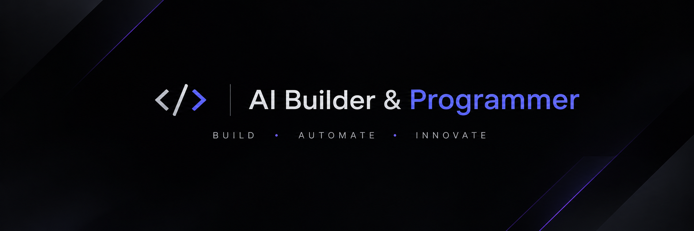

  

---

# Hey, I'm Mehmet Erim 👋

### AI Builder | AI Entrepreneur

I'm focused on Artificial Intelligence, automation, and digital product development. I believe in turning technology into practical applications and products that solve real-world problems.

---

## 👨‍💻 About Me

- 🤖 Interested in Artificial Intelligence and Generative AI.
- 🚀 Building AI-powered applications and digital products.
- ⚙️ Exploring automation systems and AI agents.
- 🐍 Developing projects with Python and Machine Learning.
- 💡 Interested in SaaS and technology startups.

---

## 🔭 Areas of Focus

- Artificial Intelligence & Generative AI
- AI-powered Applications
- AI Agents & Automation
- Machine Learning
- Web Applications & Digital Products
- SaaS & Technology Entrepreneurship

---

## 🤖 AI Toolbox

- 🧠 AI-assisted development — Exploring AI tools to accelerate software development.
- 💬 AI assistants — ChatGPT and Claude for research, problem-solving, and development.
- ⚡ AI automation — Exploring n8n and Make to build automated workflows.
- 🛠️ AI development environment — Google Antigravity and Antigravity CLI.
- 🚀 AI-powered products — Experimenting with practical applications and intelligent digital solutions.

---

## 🧰 Tech Stack

### 💻 Programming & Development

  

### 🤖 AI Assistants & Development Tools

  
  
  

### ⚙️ Automation

  
  

---

## 📂 Featured Projects

### 🏠 House Price Prediction

A machine learning-based application that analyzes real estate data to predict property prices.

**Technologies:** Python · Scikit-learn · Streamlit

---

## 📊 GitHub Statistics

  
  

---

## 📈 My Approach

I believe in learning by building. My focus is on exploring emerging technologies, developing practical solutions, and turning ideas into useful digital products.

I'm continuously improving my skills in Artificial Intelligence, Machine Learning, automation, and software development.

I value experimentation, problem-solving, and creating technology that delivers real-world value.

## 🤝 Let's Connect

I'm always interested in connecting with people who are passionate about Artificial Intelligence, technology, automation, and digital product development.

Whether it's sharing ideas, discussing projects, or exploring potential collaborations, feel free to reach out.

  
  
  

📍 Antalya, Türkiye
